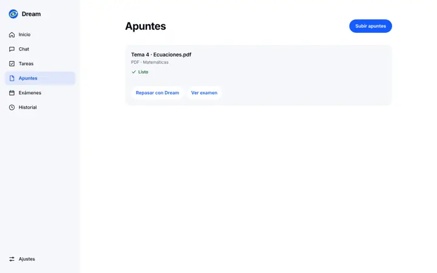
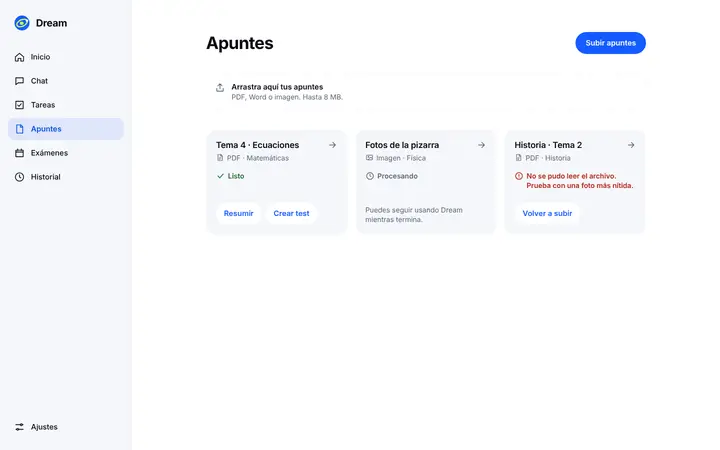
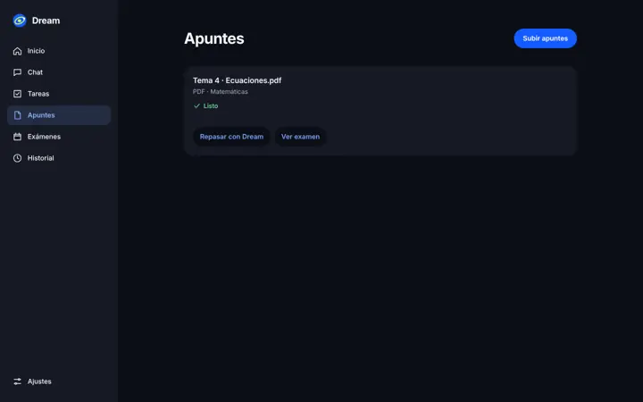
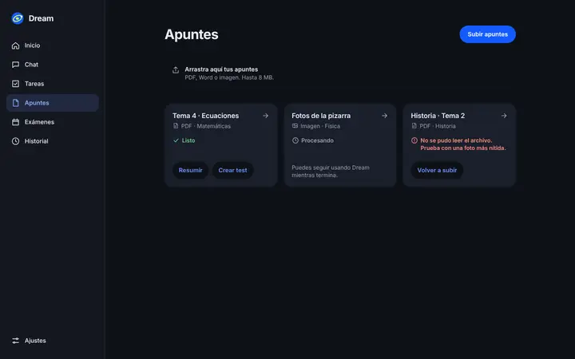
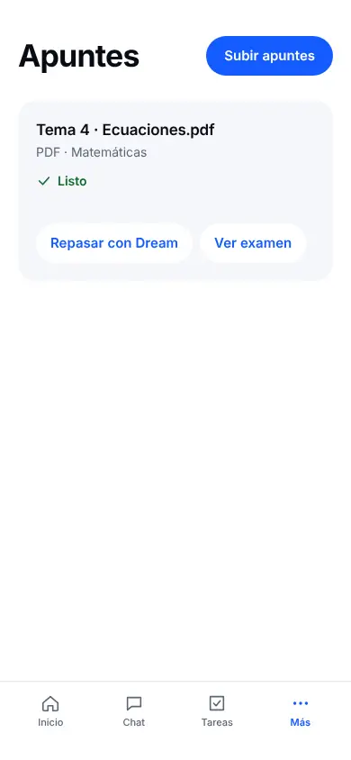
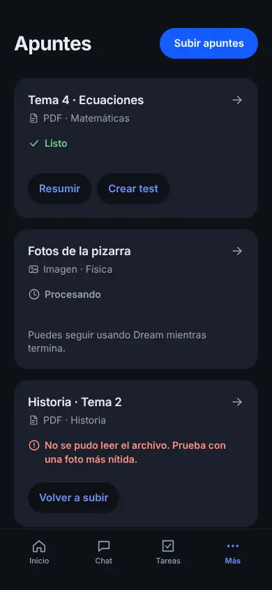

# Apuntes (`/notes`)

**Rama:** `design/apuntes`, sobre `design/cimientos`.

**Fuente que manda:** Claude Design, `Apuntes.dc.html` (escritorio, 1440 px). No hay versión móvil de Apuntes en el canvas. En móvil se usa la misma rejilla en una columna.

**Skills leídas enteras con la herramienta Skill:**
- `anthropic-skills:emil-design-eng`
- `anthropic-skills:apple-design`, con las referencias `accessibility`, `layout`, `writing`, `collections`, `loading`, `feedback`, `progress-indicators`, `motion` y `cross-platform`. También los títulos de las pautas de `color`, `typography`, `dark-mode` y `drag-and-drop`.
- `anthropic-skills:libraries-dev`

## Capturas

| | Antes | Después |
|---|---|---|
| Escritorio claro |  |  |
| Escritorio oscuro |  |  |
| Móvil claro |  |  |
| Móvil oscuro |  |  |

Las capturas de antes tienen un solo apunte, porque es lo que tenía la fixture. Las de después usan tres, como el canvas: listo, procesando y con error (`withNotes` en `tests/browser/design-fixture.ts`).

**Estados (escritorio, 1280 px):**
- Tarjeta: [reposo](apuntes-reposo.webp), [hover](apuntes-hover.webp), [pulsado](apuntes-pulsado.webp) y [foco](apuntes-foco.webp).
- Subida: [arrastrando](apuntes-arrastrando.webp), [subiendo](apuntes-subiendo.webp), [error](apuntes-error.webp) y [error en móvil](apuntes-error-movil.webp).
- Lista: [cargando](apuntes-cargando.webp) y [vacío](apuntes-vacio.webp).

**Grabación:** [`../grabaciones/apuntes.webm`](../grabaciones/apuntes.webm). Dura 12 s a 1280×800 y pesa 0,6 MB. Muestra:
1. El hover de las tres tarjetas: elevación y flecha.
2. El pulsado a 0,97.
3. El foco con el teclado.
4. El arrastre, el error con «Reintentar» y la subida.

## Cambios

| Before | After | Why |
| --- | --- | --- |
| `grid-template-columns: repeat(auto-fit, …)`: un solo apunte ocupa todo el ancho | `repeat(auto-fill, minmax(min(260px,100%),1fr))` | Claude Design usa `minmax(260px,1fr)`. Con `auto-fill`, una tarjeta conserva su ancho y con tres queda igual que el canvas. Auditoría › Apuntes; apple `collections.md › Use the standard row or grid layout` |
| Título «Tema 4 · Ecuaciones.pdf» | «Tema 4 · Ecuaciones», con el tipo en la línea de detalle («PDF · Matemáticas») e icono por tipo | Claude Design; apple `writing.md › Be clear` |
| Acciones «Repasar con Dream» y «Ver examen» | «Resumir» y «Crear test», como el canvas. Cada una abre el chat con la petición ya escrita. El estudiante la envía | Claude Design. Dream no da nada resuelto: solo resume los apuntes del estudiante y le pregunta |
| «Ver examen» era un botón más | La tarjeta entera abre su examen: el título es un enlace que cubre la tarjeta y la flecha lo indica. Un solo paso con el tabulador | apple `collections.md › Make it easy to choose an item` |
| Error en la tarjeta: «Súbelo de nuevo con más nitidez», sin acción | «No se pudo leer el archivo. Prueba con una foto más nítida.» y el botón «Volver a subir» | Claude Design; apple `writing.md › Write clear error messages` |
| Sin hover | Hover solo con puntero fino: `translateY(-2px)`, la sombra aparece con un fundido de `opacity` en `::before`, la flecha se desplaza 3 px y en oscuro la tarjeta sube a `--elevated`. 200 ms con `--ease` | emil `Only animate transform and opacity`, `Touch device hover states`; apple `dark-mode.md` (en oscuro, la profundidad son capas) |
| Sin pulsado en la tarjeta | `scale(0.97)` al pulsar la tarjeta, 160 ms | emil `Buttons must feel responsive` |
| Foco por defecto, solo alrededor del texto del título | Anillo de 2 px `--focus` alrededor de toda la tarjeta, con fundido de 120 ms | apple `accessibility.md › Let people use the keyboard alone` |
| Las tarjetas aparecían de golpe | Entrada `translateY(8px)` → 0 y opacidad en 240 ms, escalonada 40 ms y con un tope de 6. Usa `backwards`, así que no bloquea el hover | emil `Stagger Animations` (30–80 ms, sin bloquear) |
| Subir: un botón que llevaba al chat sin estados | Zona de subida con cuatro estados, cada uno con icono y texto. **Reposo:** «Arrastra aquí tus apuntes», solo con puntero fino y ≥ 640 px. **Arrastrando:** «Suelta para subir», borde `--primary`. **Subiendo:** «Preparando 2 archivos…» con barra indeterminada. **Error:** causa, consejo y «Reintentar» | apple `drag-and-drop.md › Show people whether a destination can accept dragged content`, `progress-indicators.md`; `accessibility.md › Convey information with more than color alone` |
| Errores de subida solo dentro del chat. Si había más de cuatro archivos, se cortaba sin avisar | Se valida al momento con `validateFile`. El error dice qué archivo falla, la causa y cómo arreglarlo («Usa PDF, Word, PowerPoint, Excel, una imagen o texto»). Con más de cuatro: «Puedes subir 4 archivos a la vez.» | apple `feedback.md › Show people when a command can't be carried out and help them understand why`; `writing.md › Write clear error messages` |
| Sin región viva | `aria-live="polite"` en la zona. «Preparando…» lleva `role="status"` y el error, `role="alert"` | apple `accessibility.md`; norma del encargo |
| Esqueleto: tres bloques lisos | Tres tarjetas con título, detalle, estado y dos botones, como la rejilla real. `aria-busy` y «Cargando apuntes…» para lectores de pantalla. El brillo solo cambia la opacidad y se quita con movimiento reducido | apple `loading.md › Show something as soon as possible` |
| Vacío: solo texto, sin acción | Ilustración SVG en línea con tokens (`--bg`, `--border`, `--text-secondary`, `--primary`, `--on-primary` y `--accent` en un detalle) y `aria-hidden`. Texto corto y un único botón, «Subir apuntes»: el de la cabecera se oculta para no repetirlo. Con puntero fino añade «También puedes arrastrarlos aquí.» | apple `writing.md › Provide clear next steps on any blank screens`; Auditoría › Apuntes |
| Error de carga sin icono | Icono y texto en el título del error, y «Reintentar» | apple `accessibility.md › Convey information with more than color alone` |
| Estilos de Apuntes en `globals.css` (`.card-grid`, `.note-card`, `.skeleton-card`…) | CSS Module propio: `components/notes-view.module.css`. Las reglas viejas se quitaron de `globals.css`, donde solo las usaba esta pantalla | REGLAS_DISENO.md › estilos en un módulo propio |
| — | Movimiento reducido: sin entrada que se desplaza, sin elevación ni escala, y la barra indeterminada pasa a un fundido | emil `prefers-reduced-motion`; apple `accessibility.md › Be cautious with fast-moving and blinking animations` |

## Me aparto de Claude Design en

- **La zona de arrastre no está en el canvas.**
  - El encargo pide estados de subida con icono y texto. La HIG pide mostrar si un destino acepta lo que se arrastra.
  - La he hecho discreta: una línea con borde discontinuo.
  - No se ve en táctil ni por debajo de 640 px, donde la cabecera queda como en el canvas. Al arrastrar o si hay error, aparece siempre.
- **Icono por tipo y flecha en la tarjeta.** Los pide la auditoría (§2 Apuntes) y el encargo (flecha que se desplaza).
- **`auto-fill` en vez de `auto-fit`.** Con tres apuntes se ve igual. Con uno no se estira.

## Qué hace de verdad «subiendo»

Hoy no existe un endpoint para crear apuntes desde esta pantalla: `notesSource.canCreate` es `false`, y no he tocado el backend. Los archivos se validan aquí y se pasan en memoria al chat (`lib/pending-files.ts`). Allí, el flujo de siempre los sube a `dream-api`, con su progreso y su error.

Por eso el texto dice «Preparando 2 archivos… Se abrirá el chat para analizarlos.» y no promete un porcentaje que no tenemos. La barra es indeterminada (`progress-indicators.md`). No se guarda nada en localStorage, CacheStorage ni el service worker.

## libraries-dev

- **Dónde encaja:** el estado «Procesando» de una tarjeta es una espera larga (más de 2 s). Ahí van los orbes (`thinking-orbs`).
- **Enganche:** está preparado en `data-orb-slot` dentro de `components/notes-view.tsx`.
- **No instalado:** falta el OK de Carlos.
- **Borde de luz (`border-beam`):** no lo uso. La tarjeta no es un elemento que trabaje mientras el estudiante espera delante.

## Comprobaciones

| Comprobación | Resultado |
|---|---|
| `npm run typecheck` | Sin errores |
| `npx eslint . --ignore-pattern ".claude/**"` | 0 errores, 0 avisos |
| `npm run test` (incluye `tests/design.test.ts`) | 57/57 |
| `npm run design:check` | 7/7 y contraste AA |
| Contraste de los pares nuevos (script aparte, mismos tokens) | Mínimo 4,85:1 en claro: `--primary-ink` sobre `--primary-tint`. En oscuro, 5,76:1 |
| `npm run build` | Correcto. Solo sale el aviso de Next sobre varios lockfiles, que viene del worktree dentro del repo y no de este cambio |
| Playwright (puerto 3208): `notes.spec.ts`, `design.spec.ts` completo, `dream.spec.ts` y `exams.spec.ts` | 54 pasan. Se salta 1: la grabación, que solo corre con `GRABACION_DIR` |
| Sin scroll lateral a 360, 390, 430 y 844×390, con error incluido | Pasa |
| Fluidez con la CPU ralentizada ×4 (9 hovers y un arrastre) | 0 fotogramas largos (`long-animation-frame` > 50 ms) |

## Lo que no he podido comprobar

- **Arrastre real de archivos desde el sistema operativo.** Las pruebas lanzan `DragEvent` con un `DataTransfer` real, pero no arrastran desde el Finder.
- **Táctil en un móvil real.** Solo con emulación: `hasTouch` e `isMobile`.
- **Lector de pantalla real.** He comprobado los roles y `aria-live` en el DOM, no con VoiceOver ni TalkBack.
