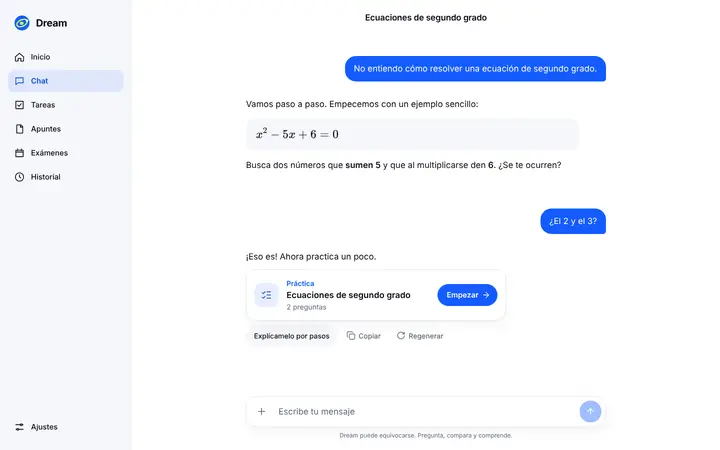
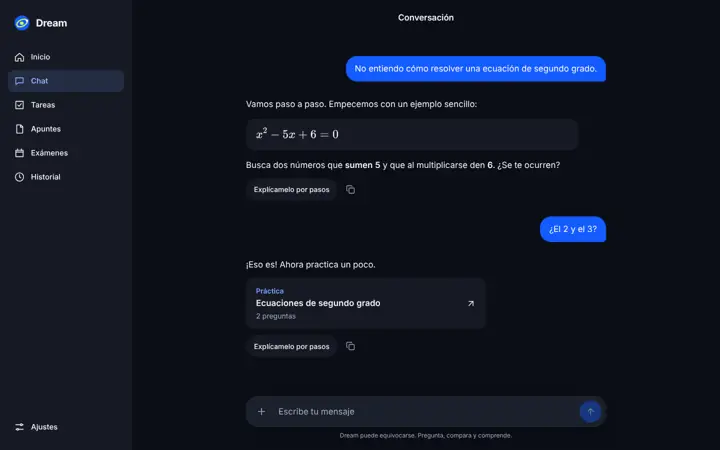
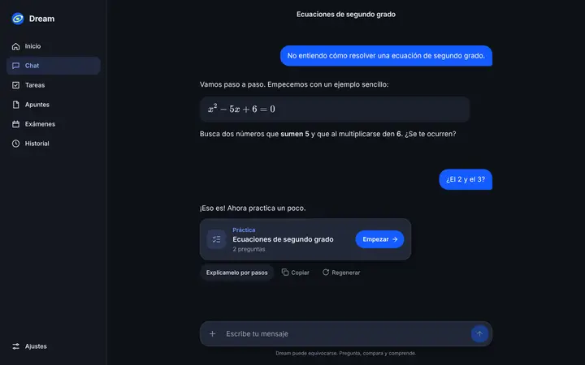
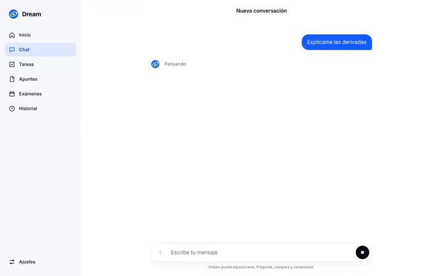
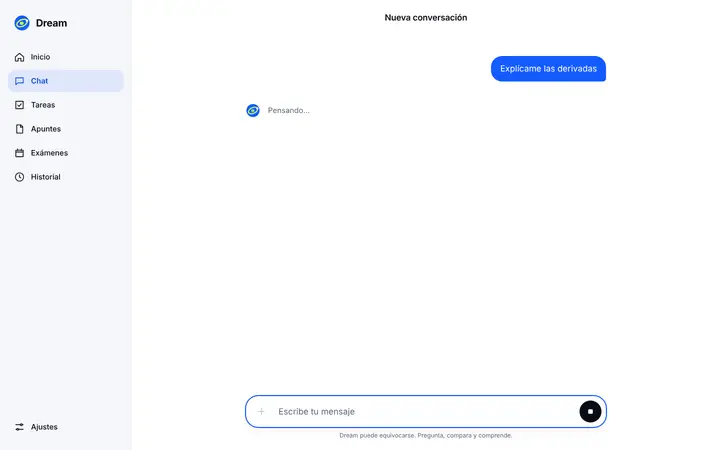
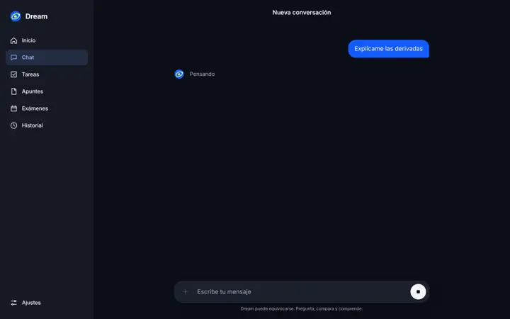
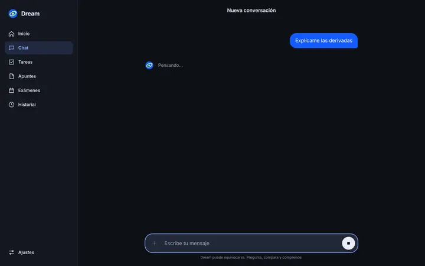

# Chat y estados de la IA

**Rama:** `design/chat` (sobre `design/cimientos`). **Referencia:** Claude Design `Chat.dc.html` (escritorio) y `MovilChat.dc.html` (móvil).

**Skills leídas:** `emil-design-eng` y `apple-design` enteras, con `generative-ai.md`, `loading.md`, `feedback.md`, `writing.md`, `motion.md`, `progress-indicators.md`, `accessibility.md` y `color.md`. De `libraries-dev`, el `SKILL.md` entero: sus archivos `references/` no existen en esta sesión.

## Capturas

| | Antes | Después |
|---|---|---|
| Escritorio claro |  |  |
| Escritorio oscuro |  |  |
| Móvil claro |  |  |
| Móvil oscuro |  |  |
| Esperando, escritorio claro |  |  |
| Esperando, escritorio oscuro |  |  |
| Esperando, móvil claro |  |  |
| Esperando, móvil oscuro |  |  |

**Grabación:** [`../grabaciones/chat.webm`](../grabaciones/chat.webm). Dura 18 s, a 1280 × 800, y pesa 426 KB. Muestra, en orden:
1. Acciones al pasar el cursor y «Copiado».
2. Hover de la tarjeta del test.
3. Envío y «Pensando…» a los 2 s. Luego «Buscando en internet…», texto con cursor y «Escribiendo…».
4. Subir durante la respuesta: aparece «Ir al último mensaje» y te devuelve abajo.
5. Parar, y «Regenerar» con una respuesta nueva.

Pasa de los 15 s porque la espera de 2 s del estado es parte de lo que se enseña.

## Cambios

| Before | After | Why |
| --- | --- | --- |
| Los mensajes aparecían de golpe | Solo el mensaje nuevo entra: `opacity 0 → 1` y `translateY(8px) → 0`, 200 ms, `--ease`, con `@starting-style`. El historial no se anima | emil › *Preventing jarring changes*; emil › *Animate enter states with @starting-style*; frecuencia alta, así que es un movimiento corto |
| No había cursor mientras llegaba el texto | Barra de 2 px tras el último bloque, parpadeo de 1 s con `steps`. Desaparece al terminar. Con movimiento reducido queda fija | emil › *Accessibility › prefers-reduced-motion*; apple `motion.md › Make motion optional` |
| «Pensando» aparecía al instante en cualquier espera | `AiStatus` con Orb de marca y una línea corta: «Pensando…», «Buscando en internet…», «Escribiendo…» y «Preparando tu test…». Preparados también «Esperando turno…» y «Reintentando…» para la cola (PR #9). Solo aparece si la espera pasa de 2 s. `role="status"` y `aria-live="polite"` | libraries-dev › *Decision rules*: «Under 2 s — Nothing»; apple `generative-ai.md › Consider giving specific, reassuring feedback`; `progress-indicators.md › Avoid vague terms like loading` |
| Auto-scroll siempre, aunque estuvieras leyendo arriba | Sigue la respuesta solo si estás a menos de 80 px del final. Si subes, aunque sea a mitad de un fotograma, deja de seguir | apple `generative-ai.md › Keep people in control`; emil › *Let people cancel motion* (apple `motion.md`) |
| No había forma de volver al final | «Ir al último mensaje», con icono y texto. Entra con fundido y 8 px y sale en 120 ms. Con movimiento reducido no se desplaza | emil › *Asymmetric enter/exit timing*; apple `accessibility.md › Convey information with more than color alone` |
| Al volver con «Ir al último mensaje» podía quedarse 85 px corto si el hilo crecía durante el desplazamiento | Al terminar el desplazamiento (`scrollend`, o 700 ms en Safari antiguo) se coloca justo abajo y sigue la respuesta | emil › *Unseen details compound* |
| Al abrir una conversación con fórmulas se quedaba 73 px por encima del final, con las acciones tapadas por la caja (se ve en `antes/chat-movil-*`) | El hilo tiene su propia altura y el `ResizeObserver` lo ve crecer. También se observa el área visible | apple `layout.md`; emil › *Handle edge cases invisibly* |
| Copiar solo cambiaba el icono | Icono y texto «Copiado», en verde, con fundido de 120 ms. Se anuncia por `aria-live` y vuelve a «Copiar» a los 1,5 s. Si falla, dice por qué | emil › *State indication*; apple `feedback.md › Make sure all feedback is accessible` |
| Las acciones se veían siempre bajo cada mensaje | Con ratón, aparecen al pasar el cursor o con el foco (fundido de 200 ms). En táctil se ven siempre. En la última respuesta se ven sin pasar el cursor | emil › *Touch device hover states*; apple `accessibility.md` (teclado) |
| No había forma de regenerar | «Regenerar» en la última respuesta, solo cuando ha terminado o se ha parado. Mientras responde está el botón de parar. Repite la última pregunta como turno nuevo y respeta el borrador y los archivos de la caja | apple `generative-ai.md › Keep people in control`: «revert or retry»; `progress-indicators.md › let people halt processing` |
| En móvil, con «Regenerar», las acciones ocupaban dos filas | En móvil, «Regenerar» es un icono de 44 × 44 con nombre accesible. Las tres acciones caben en una fila | apple `accessibility.md › Offer sufficiently sized controls`; `layout.md` |
| Botón de parar | Se mantiene, visible desde el primer momento («Detener respuesta»). Al parar: «Respuesta detenida · Lo recibido se conserva» | apple `progress-indicators.md › When it's feasible, let people halt processing` |
| Tarjeta del test plana, del color del panel, con una flecha | Tarjeta elevada (`--elevated` y sombra) con icono, tipo, título y «N preguntas» (`.num`), y un botón «Empezar» con flecha. Hover: sube 2 px, la flecha avanza 2 px y la sombra se funde. Pulsado: `scale(.98)`. Esqueleto mientras se genera | apple `branding.md`: el color en la acción principal; apple `loading.md › Show something as soon as possible`; emil › *Buttons must feel responsive* |
| «Explícamelo por pasos» | Con tilde (ya lo estaba en el código). `npm run design:check` busca palabras frecuentes sin tilde | apple `writing.md` |
| Error genérico | «No se ha podido completar» con la causa, un icono y «Reintentar», que reenvía el mismo mensaje. Si no llegó nada, el texto vuelve a la caja. En móvil, «Reintentar» baja bajo el texto | apple `feedback.md › Show people when a command can't be carried out and help them understand why`; `writing.md` (sin «nosotros») |
| Cabecera «Conversación» | El título de la conversación, o «Nueva conversación» | Claude Design (cabecera con el título); apple `writing.md` |
| Aviso de IA | Un solo aviso fijo y discreto bajo la caja en escritorio. No se repite en cada mensaje | apple `generative-ai.md › Communicate where your app uses AI`; Claude Design |
| Cada fragmento re-analizaba y remontaba todo el Markdown | Bloques memorizados: solo se vuelve a analizar el último. Las fórmulas sin cerrar no se pintan hasta cerrarse. Los fragmentos se agrupan por fotograma y KaTeX se precarga en reposo | emil › *Performance rules*; apple `motion.md` (fluidez) |

## Puntos de enganche (sin instalar)

- **`thinking-orbs`:** en `components/ai-status.tsx` está el cambio exacto. Se sustituye `<Orb … pulsing />` por `<ThinkingOrb state={…} size={20} />`, con el mapa de estados en el comentario.
- **`border-beam`:** en la caja, `data-state` en `.composer` y `useWaitLonger(since, 3000)` en `ai-status.tsx` para encenderlo a partir de 3 s.
- **Ninguno está instalado.** Hace falta el OK de Carlos: `npm install --save-exact thinking-orbs@0.3.2 border-beam@1.4.1`.

## Comprobaciones

| Comprobación | Resultado |
|---|---|
| `npm run typecheck` | sin errores |
| `npx eslint . --ignore-pattern ".claude/**"` | 0 errores, 0 avisos |
| `npm run test` | 57/57 |
| `npm run design:check` | 7/7 y contraste AA en claro y oscuro |
| `npm run build` | correcto. El único aviso es el de *workspace root*, que sale porque el worktree está dentro del repo, no por este cambio |
| Playwright, puerto 3203 | 54/54: `design.spec.ts` 26, `dream.spec.ts` 11, `exams.spec.ts` 3 y `chat-diseno.spec.ts` 14. `chat-diseno.spec.ts` además pasó 3 veces seguidas (42/42). `limits.spec.ts` no existe en esta rama |
| Fluidez con CPU ×4 (2,5 s de texto, un fragmento cada 25 ms) | 1–8 fotogramas de más de 50 ms, ninguno de 120 ms (máximo medido: 111 ms). Medido en una máquina compartida con carga de 4 a 7 en 4 núcleos. El código anterior a «Regenerar», medido igual, dio 1–5 |

## Pendiente o no comprobado

- **«Regenerar» no reemplaza la respuesta.** `dream-api` no tiene acción de regenerar, así que se hace un turno nuevo con la misma pregunta y el historial guarda las dos. Para reemplazarla hace falta un cambio en `dream-api`, y desplegarlo necesita el OK de Carlos.
- **En móvil no hay aviso de IA.** Claude Design no lo incluye y `composer-footnote` se oculta por debajo de 640 px desde antes. El texto del art. 50 va en el PR #12.
- **Sin probar en dispositivos reales:** ni el iPhone (Safari sin `scrollend`, que usa la alternativa de 700 ms) ni la vibración.
- `prefers-reduced-transparency` no aplica: el chat no usa desenfoque propio.
