# Historial (`/chat?view=recent`): evidencia

Rama `design/historial`, sobre `design/cimientos`. Manda Claude Design `Historial.dc.html`: búsqueda «Buscar en el historial», grupos con encabezado, filas con título y segunda línea, hover de fila `#F5F7FA`.

**Skills leídas enteras:** `emil-design-eng`, `apple-design` (con `accessibility`, `layout`, `typography`, `color`, `designing-for-ios`, `cross-platform`, `lists-and-tables`, `searching`, `search-fields`, `menus`, `context-menus`, `loading`, `feedback`, `undo-and-redo`, `motion` y `writing`) y `libraries-dev`.
- `libraries-dev`: aquí no hay esperas de IA. El listado tarda menos de 2 s, así que no lleva orbe ni borde de luz (regla «Under 2 s → Nothing»). No se instala nada.

## Antes | Después | Por qué

| Before | After | Why |
| --- | --- | --- |
| Muchas filas «Nueva conversación» y «ggfg» | Con el primer mensaje, el cliente llama a `conversation_rename` con un título sacado de la pregunta: espacios limpios, sin saludos, cortado por palabra hacia los 48 caracteres y con mayúscula inicial. Si el texto es basura, pone «Conversación del 15 de octubre». No usa IA | apple-design `writing.md › Be clear`; la auditoría (hallazgo 5) pide «Names come from what people control» |
| Las antiguas siguen llamándose «Nueva conversación» | La lista muestra «Conversación del 3 de octubre». Solo cambia lo que se ve: no se renombra nada en lote | apple-design `lists-and-tables.md › Keep item text succinct` |
| Grupos Hoy, Ayer, Esta semana y Anteriores | Hoy, Ayer, Esta semana (desde el lunes), Este mes y Más antiguas, siempre en ese orden y separados 32 px. La segunda línea da la hora (Hoy y Ayer), el día de la semana o la fecha, con `.num` | apple-design `layout.md › Group related items`; `lists-and-tables.md › Style` (cabeceras y espacio entre grupos) |
| › y ··· siempre visibles en cada fila | Con ratón, el chevrón queda en reposo, como en Claude Design, y «···» lo sustituye al pasar el cursor o con foco. En táctil, «···» siempre visible y sin chevrón. Botón de 44 × 44 | apple-design `layout.md › Use progressive disclosure`; emil `Touch device hover states` |
| Hover de fila `--surface-hover` | Hover `#F5F7FA` (`--surface`), solo en `(hover: hover) and (pointer: fine)`. Pulsado `scale(.97)` | Claude Design `.row:hover{background:#F5F7FA}`; emil `Buttons must feel responsive` |
| Menú sin roles, `animation: rise` desde abajo, sin teclado | `role="menu"` con `menuitem`. Sale desde la esquina del botón (`transform-origin: top right`, o `bottom right` si se abre hacia arriba) con `scale(.95)` + opacidad en 160 ms `--ease`. Admite ↑ ↓ Inicio Fin, y Escape o Tab lo cierran devolviendo el foco a «···». Iconos en los dos elementos y «Borrar» al final, en rojo y con icono | emil `Make popovers origin-aware`; apple `context-menus.md › …destructive… list them at the end`; `menus.md › Apply a uniform visual treatment` |
| Borrar abría «¿Eliminar conversación? … no se puede deshacer» | Sin diálogo. La fila se funde (opacidad + `scale(.98)`, 160 ms) y sale de la lista sin animar la altura. Aparece el toast «Conversación borrada · Deshacer»: dura 5 s, tiene `aria-live="polite"`, se alcanza con el teclado y también se deshace con Ctrl/Cmd+Z. `conversation_delete` solo se llama al acabar el plazo. Deshacer devuelve la fila a su sitio con un fundido | apple `feedback.md › don't warn people when data loss is the expected result`; `undo-and-redo.md`; emil `Only animate transform and opacity` |
| El toast no tenía tiempo ni pausa | La cuenta atrás se pausa con el cursor encima, con el foco dentro y con la pestaña oculta | emil `Sonner principles › Pause toast timers when the tab is hidden`; apple `accessibility.md › Minimize use of time-boxed interface elements` |
| Un fallo al borrar dejaba un error suelto | La fila vuelve y sale «No se pudo borrar la conversación.» con «Reintentar» (`role="alert"`) | apple `feedback.md › Show people when a command can't be carried out` |
| La búsqueda filtraba de golpe y en silencio | Las filas que aparecen se funden en 120 ms (`@starting-style`, solo opacidad, sin animar el layout). El contador «3 conversaciones» va en `role="status"`. Sin resultados: «No hay conversaciones con «…»» y el botón «Borrar búsqueda». También se encuentran por el título que se ve («octubre») | emil `Use CSS transitions over keyframes`; apple `search-fields.md › start search immediately` |
| Vacío de texto plano | Ilustración SVG en línea, solo con tokens y `aria-hidden`, más el botón «Empezar una conversación» | apple `writing.md › Provide clear next steps on any blank screens` |
| Esqueleto: tres barras genéricas | Esqueleto con la forma de la lista: etiqueta de grupo y cuatro filas con título y segunda línea. `role="status"` «Cargando». Con reduced-motion no parpadea | apple `loading.md › Show something as soon as possible` |
| Reduced motion | Menú y fila que sale: `transform: none`, solo fundido | emil `prefers-reduced-motion`; CLAUDE.md |
| Al cerrar «Cambiar nombre», el foco se perdía (`<body>`) | `Modal` guarda el elemento que lo abrió durante el render. El campo con `autoFocus` le quitaba el foco antes del efecto | apple `accessibility.md › Let people use the keyboard alone` |

**Desviaciones de Claude Design:**
- La segunda línea no muestra la asignatura: el API `conversations` solo devuelve `id`, `title` y `updated_at`. Muestra la hora, el día o la fecha. Para mostrar la asignatura haría falta cambiar `dream-api`, y eso necesita el OK de Carlos.
- Claude Design no dibuja «···». Se añade por el encargo y la auditoría, y en reposo la fila queda igual que en el diseño.

## Capturas (después)

Las de antes están en `../antes/historial-*`.

| | Claro | Oscuro |
|---|---|---|
| Escritorio | 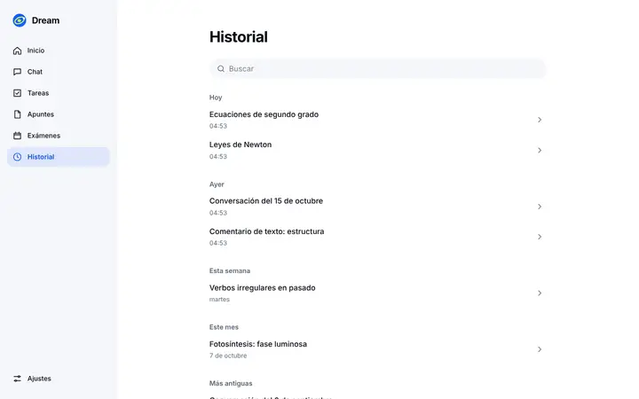 | 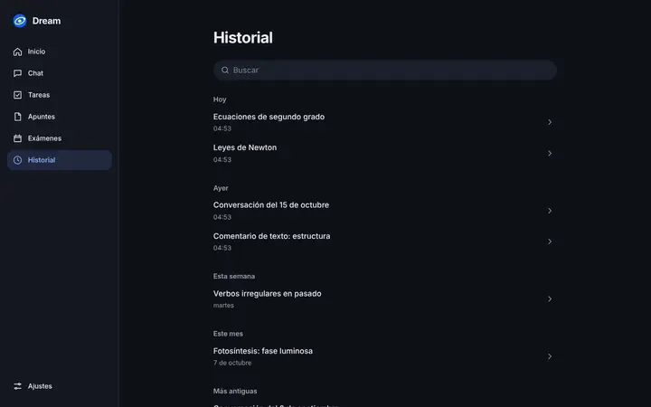 |
| Móvil (390, sin táctil emulado) |  |  |
| Móvil táctil (`···` siempre visible) |  |  |
| Hover | 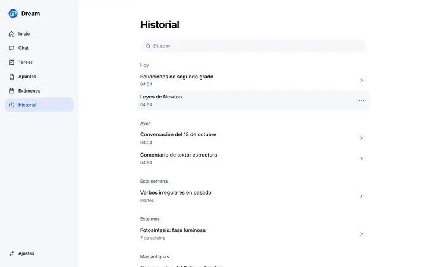 | 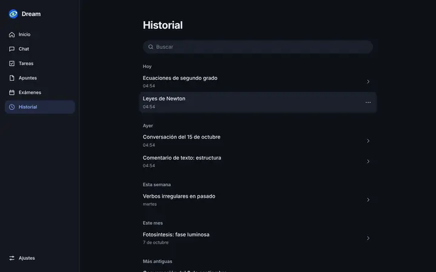 |
| Menú «···» | 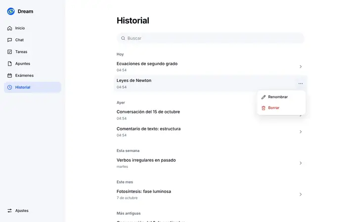 | 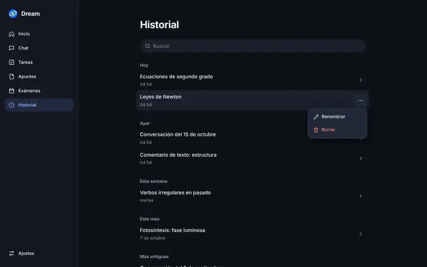 |
| Menú en móvil |  |  |
| Borrada · Deshacer | 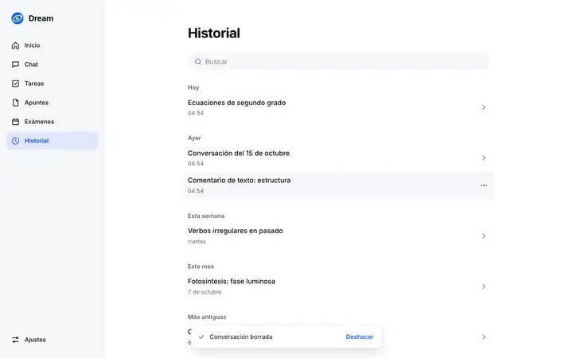 | 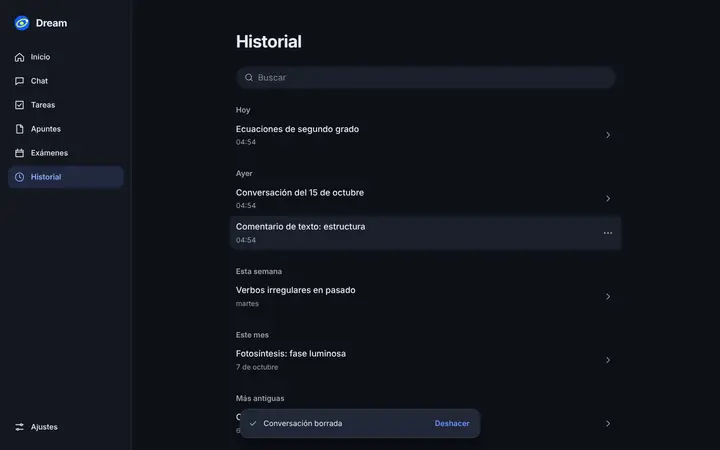 |
| Búsqueda sin resultados | 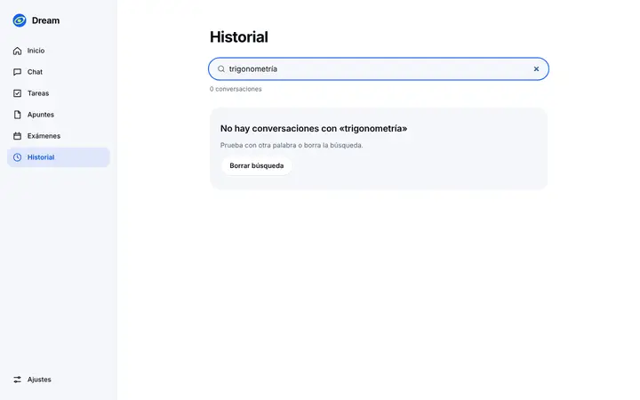 | 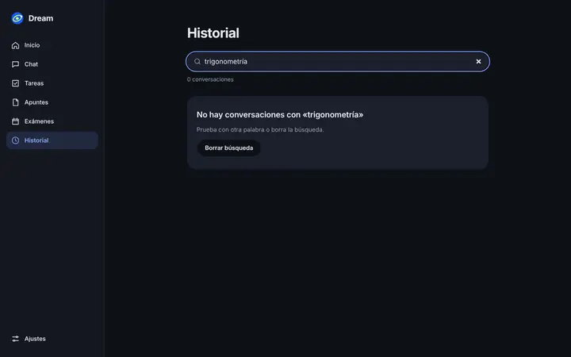 |
| Cargando / vacío |  | 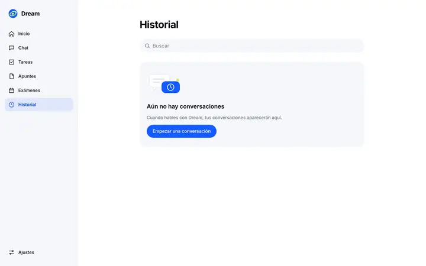 |

**Grabación:** [`../grabaciones/historial.webm`](../grabaciones/historial.webm), 1280 × 800, unos 12 s y 448 KB. Muestra el hover de las filas, el menú con el teclado (Enter, ↓, Escape), borrar y deshacer, y la búsqueda con fundido y estado vacío.

## Comprobaciones

- `npm run typecheck`: sin errores.
- `npm run lint`: 0 errores y 0 avisos.
- `npm run test`: 63/63, con `design.test.ts` y el nuevo `tests/history.test.ts`.
- `npm run design:check`: 7/7, y contraste con 41 pares «ok».
- `npm run build`: correcto. Solo sale el aviso de siempre, «inferred your workspace root», por el worktree dentro del repo. No es nuevo.
- Playwright en el puerto 3205:
  - `historial.spec.ts`: 11/11.
  - `design.spec.ts` y `dream.spec.ts`: 37/37.
  - `exams.spec.ts`, `security.spec.ts` y `observability.spec.ts`: 8/8.
- **Fluidez con CPU ralentizada:** no se ha medido. La pantalla no tiene movimiento continuo; solo el parpadeo de opacidad del esqueleto mientras carga.
