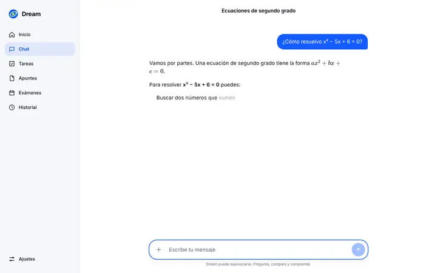
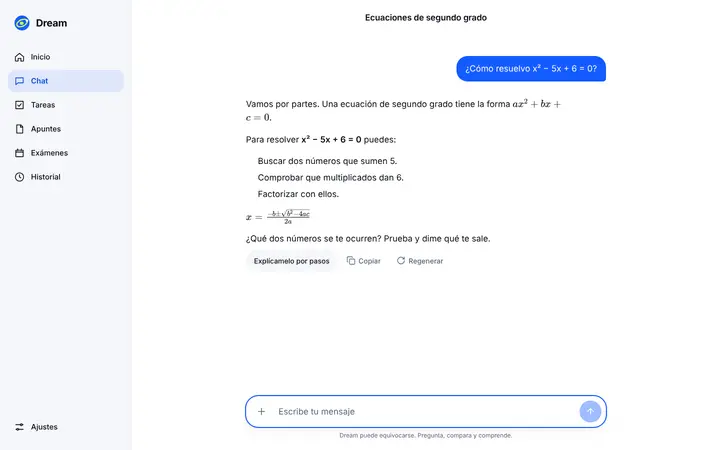
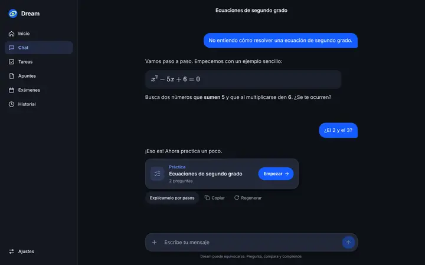
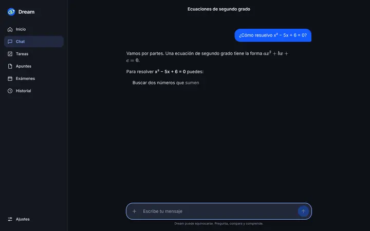
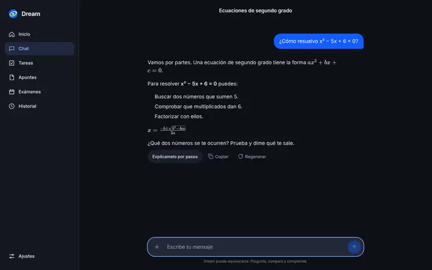

# Aparición suave de las respuestas (Parte I)

**Rama:** `feat/revelado-suave` (sobre `design/chat`). **Decidido por Carlos el 16/10/2026.**

> **Aviso honesto.** Esto **no reduce la carga en Groq ni en Cloudflare**. Se pide y se recibe lo mismo, igual de rápido: `lib/streaming.ts` y `dream-api` no cambian. Solo mejora la sensación al leer y evita repintados de React mientras aparece el texto.

**Skills leídas:** `emil-design-eng` y `apple-design` enteras, con `motion.md`, `accessibility.md`, `generative-ai.md`, `loading.md` y `feedback.md`. De `libraries-dev`, el `SKILL.md` entero: no hace falta ningún paquete y no se instala nada.

## Cómo funciona

1. El streaming no cambia. El texto recibido se pinta con su árbol de Markdown final (listas, negritas y KaTeX). Cada palabra va en un ``, y una fórmula es una sola unidad.
2. Un búfer de presentación (`lib/reveal.ts`) decide en cada fotograma (`requestAnimationFrame`) cuántas palabras se ven:
   - **Mientras llega:** enseña lo pendiente en 2 s, así que va al ritmo de la llegada.
   - **Cuando ya ha llegado:** el ritmo es «lo que falta ÷ el tiempo que queda hasta llegada + 2 s». Es constante y nunca acaba más tarde de llegada + 2 s, por larga que sea la respuesta.
   - **Nunca va más lento de 40 palabras/s.** Así, un «¡Hola!» no tarda 2 s.
3. `components/use-reveal.ts` solo añade la clase `.is-shown` a las palabras nuevas. Cada palabra aparece con un fundido de `opacity` de 160 ms con `--ease`. React no vuelve a pintar durante el revelado.
4. Los bloques que aún no han empezado no ocupan sitio. El hilo crece con lo que se puede leer y el auto-scroll no se adelanta a zonas vacías.

## Capturas

El estado final es idéntico al de `design/chat`. Lo nuevo es el estado intermedio, que antes no existía: la respuesta aparecía de golpe.

|                   | Antes (final, `design/chat`)             | Después, a mitad (0,7 s)                     | Después, final                             |
| ----------------- | ---------------------------------------- | -------------------------------------------- | ------------------------------------------ |
| Escritorio claro  |   |   |   |
| Escritorio oscuro |  |  |  |
| Móvil claro       |        |        |        |
| Móvil oscuro      |       |       |       |

**Grabación:** [`../grabaciones/revelado.webm`](../grabaciones/revelado.webm). Dura 17,5 s, a 1280 × 800, y pesa 1,05 MB.

- **Antes (8,7 s):** la respuesta llega en 0,3 s y aparece de golpe.
- **Después (8,8 s):** la misma respuesta aparece palabra a palabra en 2 s, y luego salen las acciones. En la segunda respuesta, un clic en el texto lo enseña todo al momento.

Pasa de 15 s porque enseña antes y después con la misma conversación.

## Cambios

| Before                                                          | After                                                                                                                                                                                                   | Why                                                                                                                                |
| --------------------------------------------------------------- | ------------------------------------------------------------------------------------------------------------------------------------------------------------------------------------------------------- | ---------------------------------------------------------------------------------------------------------------------------------- |
| Una respuesta que llega entera (Groq) aparece de golpe          | Aparece palabra a palabra a ritmo constante en unos 2 s. Nunca tarda más de lo que tarde en llegar + 2 s                                                                                                | emil › _Preventing jarring changes_; apple `generative-ai.md`: feedback durante la generación                                      |
| Cada fragmento volvía a pintar el último bloque de Markdown     | Igual mientras llega el texto. Durante el revelado no hay ningún render: solo cambian clases. Medido: 0 nodos añadidos o quitados del revelado al final                                                 | emil › _Performance rules_; _CSS variables are inheritable_ (se cambia la clase de cada palabra, no una variable en el contenedor) |
| —                                                               | Fundido de 160 ms (`--dur-press`, `--ease`), solo `opacity`. Las palabras no se mueven                                                                                                                  | emil › _Only animate transform and opacity_; _What easing should it use_ (entra → ease-out)                                        |
| —                                                               | Un toque o clic en la respuesta lo enseña todo al instante                                                                                                                                              | apple `motion.md › Let people cancel motion`: «don't make people wait for an animation to complete»                                |
| —                                                               | Con `prefers-reduced-motion`, la respuesta sale entera al instante                                                                                                                                      | apple `accessibility.md › Be cautious with fast-moving and blinking animations`; emil › _prefers-reduced-motion_                   |
| Copiar, Regenerar y «Explícamelo por pasos» salían con el texto | Salen al terminar el revelado, igual que la tarjeta del test y «Respuesta detenida»                                                                                                                     | No se copia ni se regenera algo que aún no se ha leído (criterio propio)                                                           |
| Al terminar, el contenido se podía volver a montar              | Se pinta el mismo árbol de principio a fin. Prueba: `getBoundingClientRect` del cuerpo, de cada bloque, de la primera y la última palabra y de la fórmula, antes y después del final: idénticos         | emil › _Unseen details compound_                                                                                                   |
| El cursor iba tras el último bloque recibido                    | Sigue a la última palabra visible y no ocupa sitio (`margin-right: -4px`), así que nada se desplaza cuando se mueve o desaparece                                                                        | emil › _Preventing jarring changes_                                                                                                |
| `aria-busy` solo mientras llegaba el texto                      | `aria-busy="true"` hasta el final del revelado en la región `aria-live="polite"` que ya existía: el lector oye el texto una vez, entero, no palabra a palabra. No se mueve el foco: se queda en la caja | apple `accessibility.md`; `motion.md › Make motion optional`                                                                       |
| El número de un paso de una lista salía antes que su texto      | El marcador espera a la primera palabra del elemento (`::marker` transparente, sin animación)                                                                                                           | Criterio propio                                                                                                                    |
| El paso «1. …» se detectaba con los hijos de texto del `h3`     | Se detecta en un plugin de rehype antes de envolver las palabras. Mismo resultado                                                                                                                       | Necesario para el revelado                                                                                                         |
| Los `span` de Markdown recibían la prop `node`                  | Se quita antes de pintar. Con un `span` por palabra importa más                                                                                                                                         | Limpieza necesaria                                                                                                                 |

## Comprobaciones

| Comprobación                                                    | Resultado                                                                                                                                                                                               |
| --------------------------------------------------------------- | ------------------------------------------------------------------------------------------------------------------------------------------------------------------------------------------------------- |
| `npm run typecheck`                                             | sin errores                                                                                                                                                                                             |
| `npx eslint . --ignore-pattern ".claude/**"` y `npm run lint`   | 0 errores, 0 avisos                                                                                                                                                                                     |
| `npm run test`                                                  | 64/64 (7 nuevas en `tests/reveal.test.ts`)                                                                                                                                                              |
| `npm run design:check`                                          | 7/7, contraste AA en claro y oscuro                                                                                                                                                                     |
| `npm run build`                                                 | correcto. Único aviso: _workspace root_, que sale por estar el worktree dentro del repo                                                                                                                 |
| Playwright, puerto 3211                                         | 61/61: `design.spec.ts` 26, `dream.spec.ts` 11, `chat-diseno.spec.ts` 14, `exams.spec.ts` 3 y `revelado.spec.ts` 7. `revelado.spec.ts` + `chat-diseno.spec.ts` pasaron también 3 veces seguidas (63/63) |
| Tiempo de revelado (≈170 palabras, llegan enteras)              | 2009–2030 ms en 5 ejecuciones                                                                                                                                                                           |
| Fluidez con CPU ×4 (≈170 palabras en 0,4 s y revelado completo) | 1–3 fotogramas de más de 50 ms. Máximo: 71 ms. Valores medidos: [56], [60], [66], [69], [70] y [71, 64, 51]. Ninguno llega a 120 ms. Máquina compartida (carga ≈ 2,9)                                   |
| Re-render durante el revelado                                   | 0 nodos añadidos o quitados (MutationObserver)                                                                                                                                                          |

## Pendiente o no comprobado

- **Lector de pantalla real:** no he podido probar VoiceOver ni TalkBack. Se comprueba `aria-busy` y que el foco no se mueve. Que el texto se anuncie una vez al quitar `aria-busy` depende del lector.
- **Teclado:** el clic para mostrarlo todo es con puntero o con el dedo. Con teclado no hay atajo, pero el revelado dura 2 s como máximo y no bloquea nada.
- **Las listas de las respuestas no tienen números ni viñetas.** El _preflight_ de Tailwind quita `list-style` y `.markdown ol/ul` no lo devuelve. Ya pasaba antes (se ve en las capturas «final»). No lo cambio aquí porque es otro tema.
- **Dispositivos reales:** sin probar en iPhone ni Android.
