# Ruta de estudio · evidencia

Rama `feat/ruta-ia` (desde `feat/ruta-estudio`, PR #10). Diseño de referencia: Claude Design
`MovilExamenes` (plan con «Hoy / Mañana / Día 3» en azul primario, tarjetas planas sobre
`--surface`). Las capturas «antes» no existen en esta rama; la columna Before describe la
versión del PR #10.

## Capturas (después)

| | Claro | Oscuro |
| --- | --- | --- |
| Móvil · camino | 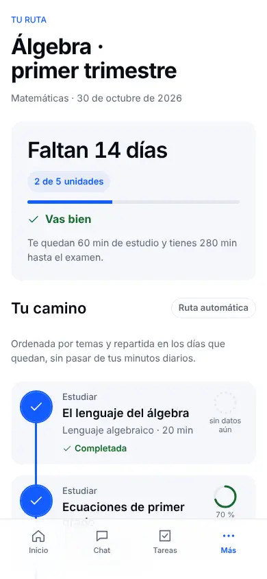 | 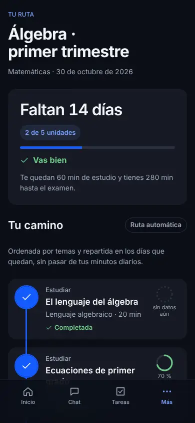 |
| Móvil · hoja inferior | 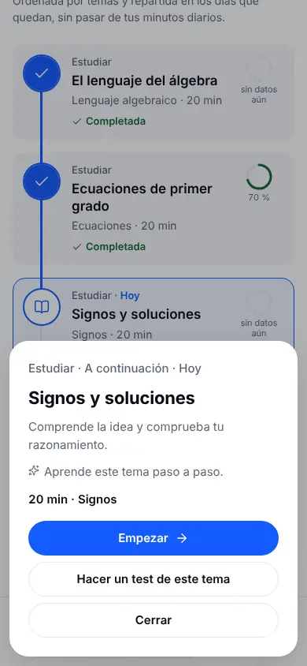 | 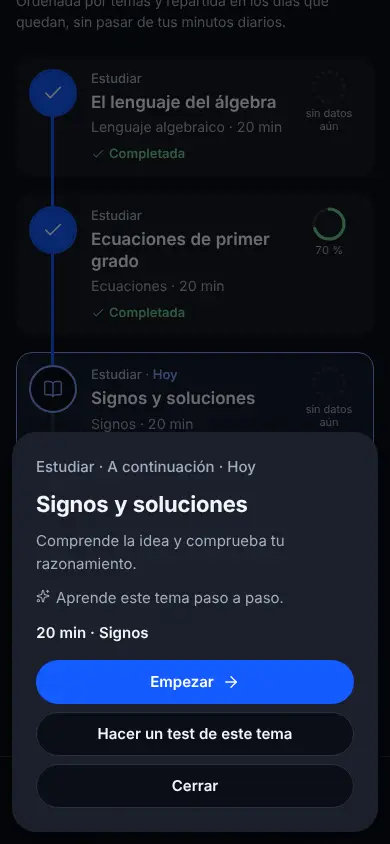 |
| Móvil · bloqueo suave | 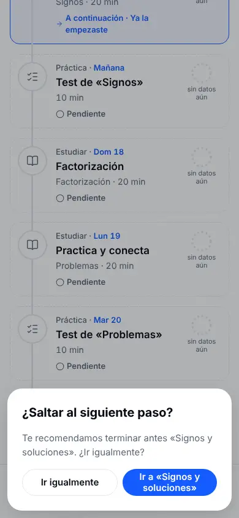 | 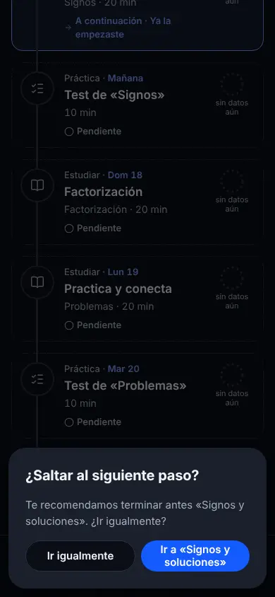 |
| Móvil · Inicio |  |  |
| Escritorio · camino | 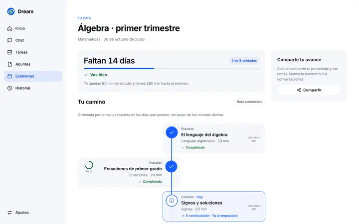 | 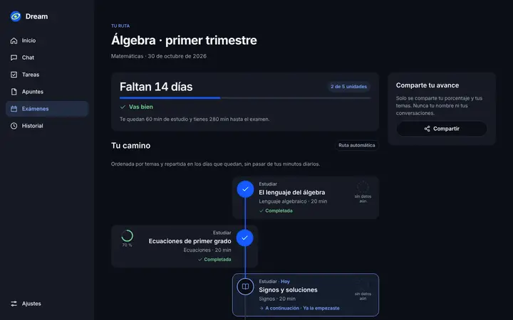 |
| Escritorio · hoja | 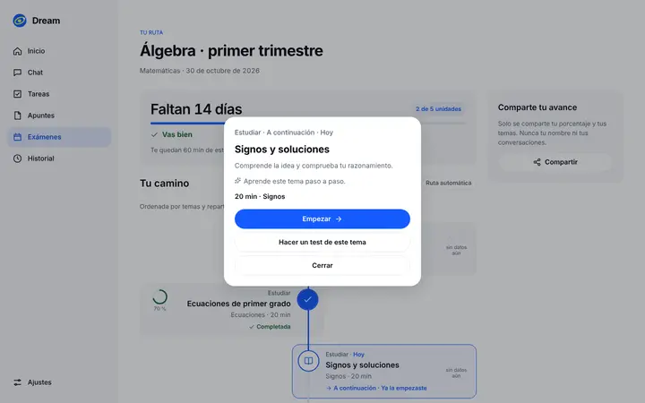 | 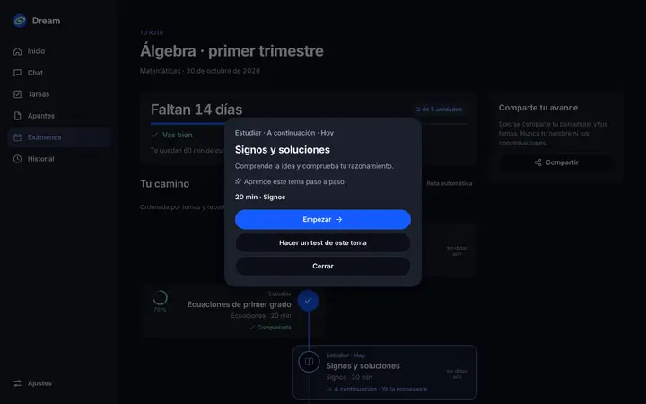 |
| Escritorio · bloqueo suave | 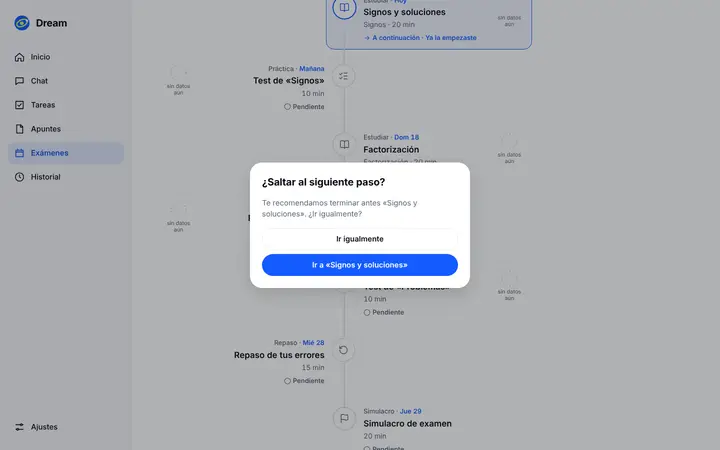 | 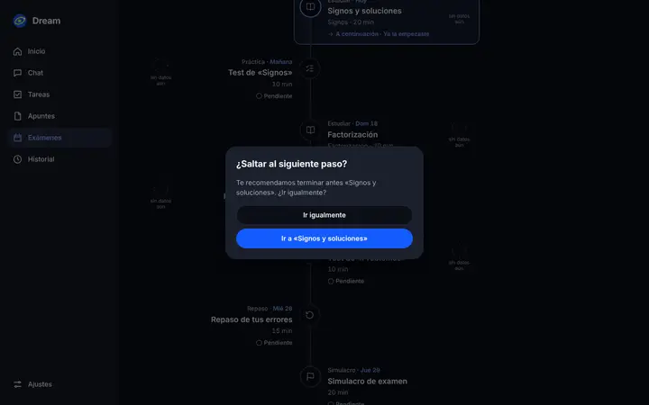 |
| Escritorio · Inicio | 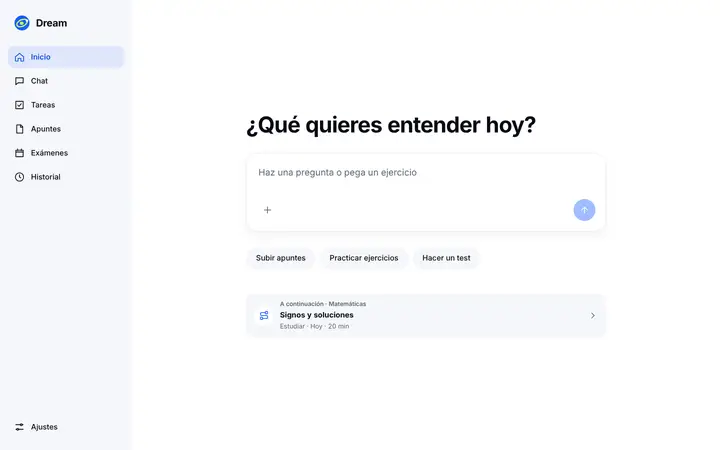 | 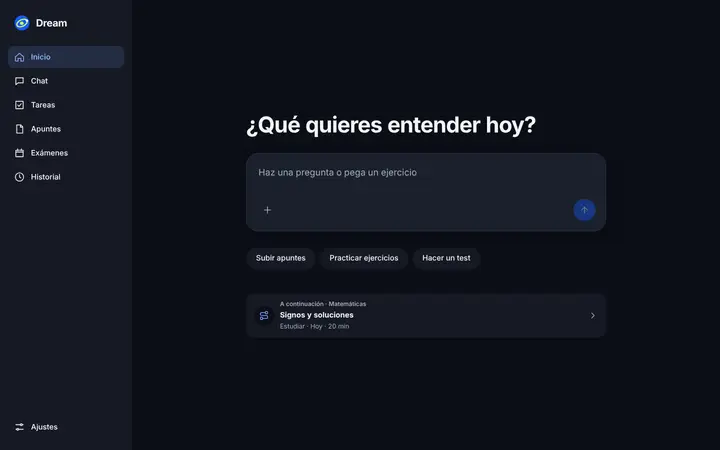 |

Grabación (390×844, 9 s): [`../grabaciones/ruta.webm`](../grabaciones/ruta.webm) — vuelta de
una unidad completada (check + trazo), hoja inferior, bloqueo suave e «Ir igualmente».

## Before | After | Why

| Before | After | Why |
| --- | --- | --- |
| Lista vertical de temas con estados «Bloqueado / Disponible / Estás aquí» | `ol` de nodos estudio · práctica · repaso · simulacro; zigzag con eje central desde 900 px, una columna en móvil | El encargo pide un camino; `layout.md` › «Layout follows available space»: misma función a cualquier ancho |
| Nodos bloqueados sin enlace (`aria-disabled`) | Bloqueo suave: «Te recomendamos terminar antes «X». ¿Ir igualmente?» con el foco en la opción recomendada | apple-design › Principio *Agency*: dejar explorar y saltar; el servidor nunca bloqueó nada |
| Estado transmitido sobre todo por color del punto | Icono + texto en cada nodo (Completada ✓, A continuación →, En curso ◉, Pendiente ○) y nombre accesible con estado, cuándo, minutos y dominio | `accessibility.md`: nada solo por color; etiquetas en controles |
| `aria-current` en «Estás aquí» | `aria-current="step"` en el primer paso sin terminar («A continuación») | Un único punto actual, predecible por teclado y lector |
| Pulso con `box-shadow` animado 3 veces | Anillo `::after` con `transform: scale` + `opacity`, 2 s en bucle, solo con `prefers-reduced-motion: no-preference` | emil-design-eng › «Only animate transform and opacity»; indicador en bucle permitido |
| Trazo gris/azul que cambia de color de golpe | Trazo con relleno `scaleY(0.001 → 1)`, 250 ms `--ease`, 120 ms tras el check | emil-design-eng › «What is the purpose?»: explica el avance; ≤ 250 ms |
| Sin celebración al volver de una unidad | `?hecho=<unidad>`: el check se «dibuja» (barrido con dos `translateX` opuestos, 250 ms) y el siguiente pasa a «A continuación»; aviso `role="status"` | Momento poco frecuente → puede tener algo de deleite; solo transform/opacity |
| — | Reduced-motion: transiciones a 0 s y sin pulso; el estado final es idéntico | emil-design-eng › Accessibility › prefers-reduced-motion |
| Nodo enlazaba directo a la unidad | Hoja inferior (Modal: abajo en móvil, centrada en escritorio) con resumen, motivo, minutos, «Empezar» y «Hacer un test de este tema»; Escape y foco atrapado | `sheets.md` › «scoped task closely related to the current context»; «Cerrar» además de la acción |
| Porcentaje grande sin contexto de tiempo | «Faltan 14 días», barra de unidades y frase calculada: «Vas bien», «Vas justo» o «Vas tarde, conviene subir los minutos diarios» con el cálculo a la vista | `progress-indicators.md` › «Be as accurate as possible»; icono + texto |
| — | Anillo de dominio por tema (aciertos medios de tests de ese tema) o anillo punteado «sin datos aún» | Sin afirmar dominio sin datos (regla de producto) |
| — | «Hoy», «Mañana», «Jue 22» en azul primario en cada nodo | Claude Design `MovilExamenes` usa la fecha en primario como etiqueta |
| — | Simulacro final enlazado a «Simulacro de examen» (`/exams/[id]#simulacro`), resaltado con ≤ 1 unidad pendiente o ≤ 3 días | Decisión de Carlos: mismo nombre que el botón del detalle |
| — | Estados: plan generándose (indicador de Dream; enganche para thinking-orbs), error con «Reintentar», sin unidades, sin conexión | `loading.md` / `feedback.md`: siempre algo útil en pantalla |
| — | Tarjeta «A continuación» en Inicio (solo si hay examen) bajo los atajos; no cambia el resto de Inicio | Reduce un paso para retomar; sin rachas ni puntos |
| Compartir con texto | Igual (Web Share API o portapapeles), solo % y temas | Sin datos personales; probado |

## Comprobaciones

- `npm run typecheck`: OK.
- `npx eslint . --ignore-pattern ".claude/**"`: 0 errores, 0 avisos.
- `npm run test`: 73/73 (incluye 17 de `tests/route-plan.test.ts` y 6 de `tests/study-path.test.ts`).
- `design:check`: no existe en esta rama.
- `npm run build`: OK; único aviso, el de «workspace root» por el worktree anidado (preexistente).
- Playwright (puerto 3213): `dream.spec.ts` 11/11, `exams.spec.ts` 3/3, `study-path.spec.ts` 11/11.
  `design.spec.ts` y `capturas.spec.ts` no existen en esta rama.
- Fluidez con CPU ×4 (abrir/cerrar hoja y aviso con el pulso activo): 265 fotogramas,
  4 > 34 ms, 2 > 50 ms (máx. 57 ms, al montar el diálogo).
